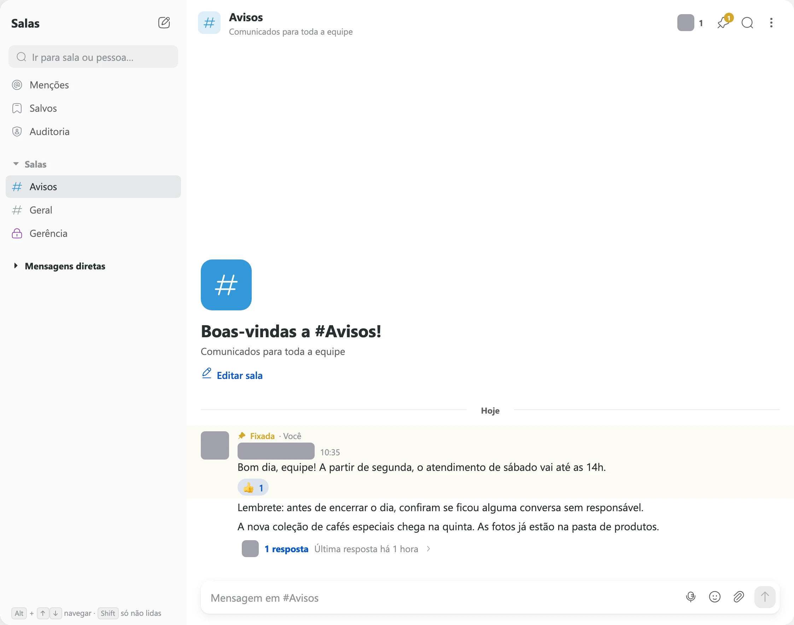

**Salas** é o chat interno da equipe na Kinbox, um espaço para os membros do workspace conversarem entre si, separado das conversas com clientes. A área reúne **salas** (públicas ou privadas, organizadas por assunto ou por equipe, como **Avisos** ou **Vendas**) e **mensagens diretas** (entre duas pessoas). O cliente nunca vê o que a equipe escreve nas salas nem nas mensagens diretas.

<Note>
  Quem pode usar no workspace (na tela, **ambiente**):

  - **Usar as salas:** todo membro, exceto quem tem no papel a restrição **Não pode acessar as salas** (quadro **Restrições** da seção **Outros**). O proprietário nunca é bloqueado. Se o botão **Salas** não aparecer no topo, peça a quem administra o workspace para tirar **Não pode acessar as salas** do seu papel.
  - **Criar, editar, clonar, ordenar e excluir salas:** quem tem a permissão **Salas** (seção **Gerenciamento do Ambiente**) ou o proprietário. Os papéis prontos **Atendente**, **Supervisor** e **Administrador** já trazem essa permissão.
  - **Auditar mensagens diretas:** quem tem a permissão **Auditar mensagens diretas** (seção **Outros**) ou o proprietário. Nenhum papel pronto traz essa permissão.

  Veja [Criar papéis e permissões](/docs/configuracoes-no-workspace/configurar-permissoes-dos-usuarios) e [Referência de permissões](/docs/administracao/referencia-de-permissoes).
</Note>

## Onde ficam

As **Salas** não têm item no menu lateral nem em **Configurações**. Para abrir, clique no botão **Salas** (ícone **@**) no topo da tela, à direita. O botão mostra um número amarelo com o total de mensagens não lidas (`99+` a partir de 100); salas silenciadas não entram nessa conta.

Você também pode ir direto a uma sala pela busca do topo (**Pesquisar**, `Ctrl+K` ou `⌘K`, descrita em [Caixa de entrada: visão geral](/docs/conversas/caixa-de-entrada-do-kinbox)), no grupo **Salas**. No computador, o painel abre na lateral da tela.

<Frame caption="Painel Salas aberto na lateral: lista à esquerda e sala Avisos no centro">
  
</Frame>

O painel mostra a lista à esquerda e a sala aberta no centro. Ao abrir **Membros**, **Mensagens fixadas**, a busca ou uma **Thread**, aparece uma terceira coluna, à direita. Na lista ficam o campo "Ir para sala ou pessoa…", os atalhos **Menções**, **Salvos** e **Auditoria** (este aparece apenas para quem tem a permissão) e as seções **Salas** e **Mensagens diretas**.

## Salas públicas, privadas e mensagens diretas

| Tipo | Quem vê | Como aparece na lista |
| --- | --- | --- |
| **Sala pública** | Todos os membros do workspace que têm acesso às salas | Na seção **Salas**, com o ícone **#** |
| **Sala privada** | Só os membros escolhidos na sala e o proprietário do workspace, que vê todas as salas, inclusive as privadas | Na seção **Salas**, com o ícone de cadeado |
| **Mensagem direta** | Na lista, aparece só para as duas pessoas. O proprietário e quem tem **Auditar mensagens diretas** podem lê-la em modo somente leitura, exceto as que envolvem o proprietário | Na seção **Mensagens diretas**, com o nome do colega |

Todo workspace novo já começa com a sala pública **Geral**. Ela funciona como uma sala comum: quem tem a permissão **Salas** ou é o proprietário pode editá-la ou excluí-la.

A seção **Mensagens diretas** já traz os colegas que você pode chamar, mesmo sem mensagem anterior. Se o seu papel tiver a restrição **Só pode ver membros que sejam dos seus grupos nos DMs.**, você só vê e manda mensagem direta para colegas que têm algum grupo em comum com você (veja [Criar grupos de atendimento](/docs/configuracoes-no-workspace/criar-e-gerenciar-grupos)).

Não confunda as **Salas** do chat interno com as salas físicas cadastradas no Kinbox Agenda: são recursos diferentes.

## O que dá para fazer

- [Criar salas](/docs/salas/usar-salas#criar-uma-sala) com nome, cor, descrição e privacidade, e [editar, clonar, ordenar ou excluir](/docs/salas/usar-salas#editar-clonar-ordenar-ou-excluir-uma-sala) as que já existem.
- [Mandar mensagens de texto, emojis, arquivos e áudios](/docs/salas/usar-salas#mandar-mensagens-arquivos-e-áudios) em salas ou em [mensagens diretas](/docs/salas/usar-salas#mensagens-diretas).
- [Mencionar colegas com @](/docs/salas/usar-salas#mencionar-um-colega) para destacar a mensagem e avisar a pessoa.
- [Reagir, responder citando, responder em thread, editar, excluir, fixar e salvar mensagens](/docs/salas/usar-salas#ações-numa-mensagem).
- [Acompanhar Menções e Salvos e buscar mensagens](/docs/salas/usar-salas#menções-salvos-e-busca) em uma sala ou em todas as salas.
- [Controlar mensagens não lidas e silenciar uma sala](/docs/salas/usar-salas#não-lidas-e-silenciar) sem deixar de ver o conteúdo.
- [Auditar as mensagens diretas dos membros](/docs/salas/auditar-mensagens-diretas) em modo somente leitura, quando você é o proprietário ou tem a permissão **Auditar mensagens diretas**.

## O cliente vê o que a equipe escreve?

Não. Nada escrito nas salas nem nas mensagens diretas chega ao cliente: nenhuma mensagem sai por WhatsApp, Instagram, e-mail ou qualquer outro canal, nem passa por bot ou agente de IA. As mensagens ficam apenas entre os membros do workspace, seguindo as regras de visibilidade acima.

Para conversar com a equipe **dentro** de uma conversa com cliente (também sem o cliente ver), use as notas internas (**Nota pro time**): veja [Atender uma conversa: responder, notas, resolver e reabrir](/docs/conversas/gerenciar-conversas). A nota interna fica ligada àquele atendimento; a sala é um chat interno à parte.

## No celular

No app da Kinbox para celular, a aba **Salas** (entre **Conversas** e **Agenda**) reúne as mesmas salas e mensagens diretas do computador. O app funciona em iPhone e celular Android (veja [App da Kinbox para celular: o que dá para fazer](/docs/app/visao-geral)).

## Veja também

- [Conversar nas salas: mensagens diretas, menções e threads](/docs/salas/usar-salas)
- [Auditar as mensagens diretas dos membros](/docs/salas/auditar-mensagens-diretas)
- [Receber notificações no navegador e no celular](/docs/conta/notificacoes)
- [Workspace, membros e papéis](/docs/conceitos/workspace-membros-e-papeis)
- [Glossário](/docs/conceitos/glossario)
