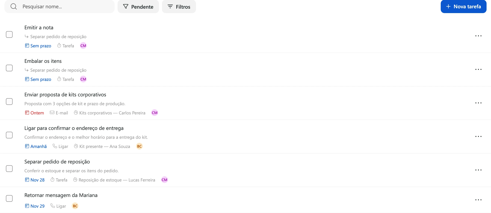
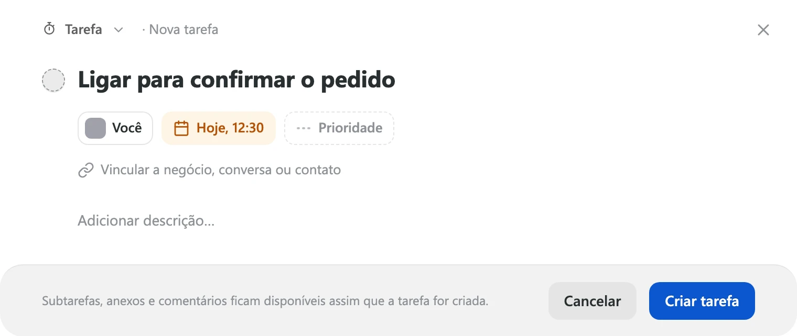
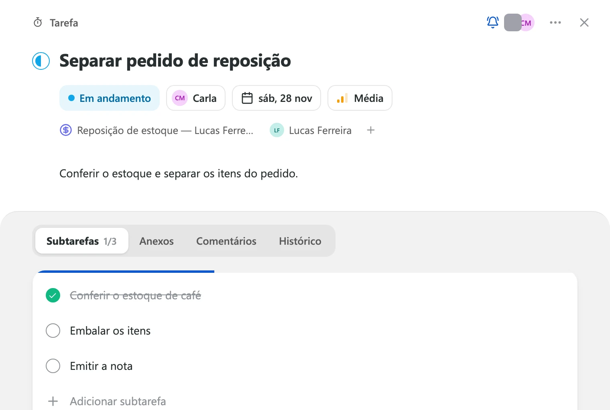
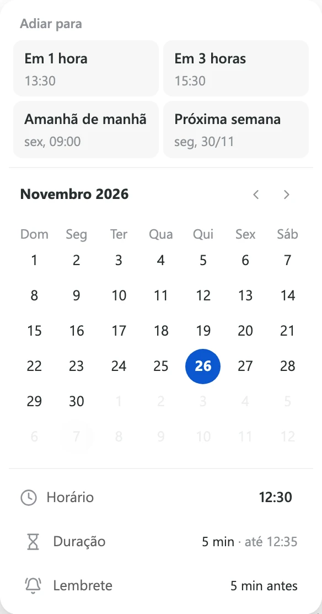

Use **Tarefas** para organizar o que a equipe precisa fazer — como ligações, reuniões, prazos e follow-ups — com responsável, prazo, prioridade, vínculos com negociação, conversa ou contato, subtarefas, anexos, comentários e inscritos.

<Note>
  Quem pode: todos os membros acessam **Tarefas**. Algumas opções dependem do seu papel, e cada passo abaixo diz qual permissão pede. Veja [Referência de permissões](/docs/administracao/referencia-de-permissoes).
</Note>

## Onde ficam as tarefas

Clique no ícone **Tarefas** no menu lateral (o nome aparece ao passar o mouse). Você também pode ver as tarefas em formato de agenda pelo ícone **Calendário** no topo da tela. Para acompanhar as tarefas num painel, use os modelos **Tarefas** e **Calendário de tarefas** de um dashboard (veja [Criar dashboards](/docs/relatorios/dashboard)).

Na barra superior da lista ficam o campo **Pesquisar nome...** (procura apenas pelo nome da tarefa), o seletor de situação (que abre em **Pendente**), **Filtros**, **Nova tarefa** e o menu **⋯** no canto superior direito.

As situações disponíveis são **Concluída**, **Pendente** (tarefas não concluídas e não canceladas, incluindo **Em andamento**), **Atrasado** (tarefas com prazo vencido, ainda não concluídas nem canceladas), **Hoje**, **Amanhã**, **Essa semana**, **Próxima semana**, **Esse mês** e **Próximo mês**.

Cada linha exibe a caixinha para concluir, o nome, a descrição (ou `↳` com o nome da tarefa principal, quando for uma subtarefa — subtarefas aparecem na lista como linhas próprias), o prazo, o tipo, a negociação ou conversa vinculada, o avatar do responsável e o menu **⋯** (**Visualizar** e **Excluir**). Prazos vencidos aparecem em vermelho.

Se o seu papel tem a permissão **Gerenciar agendamentos**, os agendamentos do **Kinbox Agenda** também aparecem nessa lista, com o selo **Kinbox Agenda**.

<Frame caption="Lista de tarefas com busca, seletor de situação Pendente, Filtros, botão Nova tarefa, menu ⋯, subtarefas e tarefa atrasada em vermelho">
  
</Frame>

## Criar uma tarefa

<Steps>
  <Step title="Abra a janela de nova tarefa">
    Em **Tarefas**, clique em **Nova tarefa** (ou em **Criar nova tarefa**, se a lista ainda estiver vazia). A janela abre em rascunho.
  </Step>

  <Step title="Preencha os dados da tarefa">
    Digite o nome em **O que precisa ser feito?** (por exemplo, `Ligar para confirmar o endereço de entrega`), ajuste o tipo no canto superior esquerdo se precisar e defina o responsável (começa em **Você**), o prazo, a **Prioridade**, os vínculos em **Vincular a negócio, conversa ou contato** e a descrição em **Adicionar descrição…**.

    <Frame caption="Janela de nova tarefa com nome, responsável, prazo, prioridade, vínculos e botão Criar tarefa">
      
    </Frame>
  </Step>

  <Step title="Salve a tarefa">
    Clique em **Criar tarefa** (ou pressione `Enter` no campo de nome). O botão **Criar tarefa** fica desativado enquanto o nome estiver vazio. A Kinbox confirma com "Tarefa criada", e as abas de subtarefas, anexos, comentários e histórico passam a ficar disponíveis.
  </Step>
</Steps>

Se você fechar um rascunho com `Esc` ou **✕**, o que foi preenchido é descartado sem pedir confirmação.

### Outros lugares para criar

Você também pode encontrar essas tarefas na lista de **Tarefas**, conforme os filtros e o seu papel:

- **Na conversa:** no painel **Detalhes** da conversa na [Caixa de entrada](/docs/conversas/caixa-de-entrada-do-kinbox), abra a seção **Tarefas** e clique em **+**. A tarefa já nasce vinculada à conversa e ao contato, atribuída ao responsável da conversa (ou a você). Se a seção **Tarefas** não aparecer na conversa, falta a permissão **Pode gerenciar as tarefas da conversa.**.
- **Na negociação:** clique no botão **Tarefa** abaixo da caixa de comentário. A tarefa nasce vinculada à negociação, ao contato e à conversa associada, com o responsável da negociação — veja [Trabalhar com negociações no funil](/docs/crm/gerenciando-funil-de-vendas).
- **No perfil do contato:** abra a aba **Tarefas** na ficha do contato — veja [Contatos: encontrar, cadastrar, editar e excluir](/docs/conversas/clientes-contatos-e-organizacoes).
- **No Calendário:** clique no ícone **Calendário** no topo da tela e clique em um horário (ou em um dia inteiro) para criar a tarefa. No calendário, você também pode arrastar uma tarefa para outro horário e esticar o bloco para mudar a duração.
- **Por cadência de funil:** etapas com cadência criam tarefas automaticamente quando a negociação entra na etapa — veja [Cadências: tarefas automáticas por etapa](/docs/crm/cadencias). Tarefas de cadência exibem "Cadência" no rodapé da janela (e "Obrigatória" quando impedem a negociação de mudar de etapa enquanto estiverem pendentes).

## Preencher a tarefa

Depois que a tarefa é criada, cada alteração é salva na hora (nome e descrição salvam assim que você sai do campo).

<Frame caption="Tarefa aberta com status, responsável, prazo, prioridade, vínculos e abas de subtarefas, anexos, comentários e histórico">
  
</Frame>

- **Tipo:** clique no tipo no canto superior esquerdo para escolher entre **Tarefa** (padrão), **Ligar**, **Reunião**, **Deadline**, **Almoço**, **E-mail**, **Agendamento** e **Iniciar bot**.
  - O tipo **E-mail** apenas identifica a tarefa e não envia nenhum e-mail.
  - **Agendamento** só aparece numa tarefa nova e se o seu papel tem a permissão **Gerenciar agendamentos** — escolhê-lo troca a janela para o formulário de agendamento do **Kinbox Agenda**.
  - **Iniciar bot** só aparece com a tarefa vinculada a uma conversa. Ele permite escolher o **Bot** (veja [Bot: visão geral](/docs/bot/visao-geral)) e ligar **Auto executar** para iniciar o bot na conversa no horário do prazo e concluir a tarefa automaticamente.
- **Responsável:** clique no botão do responsável (que mostra **Você** ou o primeiro nome do membro, como **Carla**) para buscar e escolher outro membro. O novo responsável passa a seguir a tarefa e recebe um aviso na Kinbox.
- **Prioridade:** clique em **Prioridade** para escolher **Urgente**, **Alta**, **Média**, **Baixa** ou **Sem prioridade**.
- **Vínculos:** clique em **Vincular a negócio, conversa ou contato** (ou em **+**) para associar a tarefa a uma negociação ("Buscar negócio"), a uma conversa (informe o protocolo ou número, como `30041687`) ou a um contato ("Buscar contato"). Passando o mouse sobre o vínculo, aparecem **Abrir negócio**, **Ver conversa**, **Abrir contato** e **Desvincular**.
- **Campos personalizados:** se o workspace tiver campos personalizados de tarefa, eles aparecem entre os vínculos e a descrição. Clique no valor para editar e confirme em **Salvar** — veja [Criar campos personalizados](/docs/configuracoes-no-workspace/campos-personalizados-no-kinbox).
- **Copiar link:** no menu **⋯** do topo da janela, clique em **Copiar link** para copiar o endereço direto da tarefa.

## Prazo e lembrete

Clique no botão do prazo para abrir o seletor de data, horário, duração e lembrete. Enquanto a tarefa não está concluída nem cancelada, o topo do quadro traz os atalhos de **Adiar para** (**Em 1 hora**, **Em 3 horas**, **Amanhã de manhã** e **Próxima semana**), com opção de **Desfazer** no aviso exibido logo após o adiamento.

<Frame caption="Quadro do prazo com atalhos de Adiar para, calendário, Horário, Duração e Lembrete">
  
</Frame>

Em **Horário**, escolha o horário (de 5 em 5 minutos); em **Duração**, defina o tempo da tarefa; em **Lembrete**, escolha **Na hora**, **5 min antes** (padrão), **15 min antes**, **30 min antes**, **1 hora antes** ou **1 dia antes**.

Como o lembrete funciona:

- Só existe com **horário** no prazo e precisa cair no **futuro** quando você cria a tarefa ou muda o prazo ou o lembrete.
- Vai **só para o responsável** atual no momento do aviso (inscritos não recebem lembrete) e não dispara se a tarefa já estiver concluída ou cancelada.
- Chega **dentro da Kinbox**, no sino de notificações e, com a Kinbox aberta, como aviso na tela com som (o som segue **Quando receber mensagem de time** em [Receber notificações no navegador e no celular](/docs/conta/notificacoes)).
- **Não** há push no celular, e-mail nem aviso de tarefa atrasada — quando o prazo passa, a tarefa fica vermelha na lista e entra na situação **Atrasado**.

<Tip>
  Com o prazo e o lembrete que vêm na tarefa nova (próximo horário de 5 em 5 minutos e **5 min antes**), o momento do aviso já passou. Para receber o lembrete, escolha um horário mais à frente ou um lembrete que caia no futuro.
</Tip>

## Status e concluir

Na janela da tarefa, clique no botão de status para alternar entre **Pendente**, **Em andamento**, **Concluída** e **Cancelada**, ou clique no círculo ao lado do nome para concluir.

Se você concluir pela janela uma tarefa que ainda tem subtarefas abertas (não concluídas e não canceladas), a Kinbox avisa quantas subtarefas faltam e pergunta se você quer clicar em **Concluir tudo** (conclui a tarefa e as subtarefas juntas) ou **Cancelar**. Pela caixinha da lista de **Tarefas**, apenas a tarefa clicada é concluída, sem alterar as subtarefas.

## Subtarefas

Na aba **Subtarefas**, divida uma tarefa em etapas menores — por exemplo, na tarefa "Separar pedido de reposição", as subtarefas "Conferir o estoque de café", "Embalar os itens" e "Emitir a nota". Digite o nome (até 300 caracteres) e pressione `Enter`.

A subtarefa nasce com o mesmo responsável da tarefa principal, sem prazo e sem os vínculos da principal. Clique no nome dela para abrir a janela própria e editar status, prioridade, prazo (inclusive **Remover prazo**), anexos e comentários; clique em **←** no topo para voltar à tarefa principal. A Kinbox aceita **um nível** de subtarefas: não é possível criar subtarefas dentro de outra subtarefa.

## Anexos e comentários

- **Anexos:** na aba **Anexos**, clique em **Anexar arquivo** ou arraste o arquivo para a janela da tarefa. Para remover, clique em **Remover anexo** e confirme.
- **Comentários:** na aba **Comentários**, escreva uma observação e use `@` para mencionar membros. Quem comenta e quem é mencionado passam a seguir a tarefa automaticamente. Você pode reagir a comentários e editar ou excluir os seus próprios comentários.

## Histórico

A aba **Histórico** mostra as principais mudanças da tarefa, da mais recente para a mais antiga.

## Quem acompanha a tarefa

Clique no ícone de sino no topo da janela para abrir **Inscritos** e usar **Seguir** ou **Adicionar pessoa**. Os inscritos recebem aviso na Kinbox quando a tarefa é concluída ou comentada.

## Encontrar e organizar

- **Filtros:** clique em **Filtros** para combinar **Tipo**, **Membro** (disponível para quem tem **Pode ver tarefas atribuídas a outros.**) e **Período** do prazo (com atalhos como **Hoje**, **Ontem**, **Últimos 7 dias**, **Últimos 30 dias**, **Esse mês** e **Mês passado**) e clique em **Filtrar**.
- **Ações em lote:** no menu **⋯** do canto superior direito da lista, clique em **Executar ação...** para abrir **Executar ação em lote**, escolher **Atribuir todas as tarefas para um membro** ou **Resolver todas as tarefas** (concluir) e clicar em **Executar**. Se **Executar ação...** não aparecer, falta a permissão **Transferir tarefas em massa**. Agendamentos do Kinbox Agenda não entram nas ações em lote.

<Warning>
  **Executar ação...** vale para **todas as tarefas da lista com a situação e os filtros aplicados**, inclusive as das outras páginas. Confira a situação e os filtros antes de clicar em **Executar**.
</Warning>

- **Exportar:** no menu **⋯** do canto superior direito da lista, clique em **Exportar** e escolha **CSV** ou planilha do Excel para baixar todas as tarefas da lista com a situação e os filtros aplicados.

## Excluir uma tarefa

Para excluir, abra o menu **⋯** na linha da lista e clique em **Excluir** (ou, na janela da tarefa, clique em **⋯** → **Excluir tarefa** ou **Excluir subtarefa**). Informe o motivo em **Motivo da exclusão...** (obrigatório) e clique em **Excluir**.

Se **Excluir** não aparecer, seu papel tem a restrição **Proibir excluir tarefas** (o proprietário sempre pode excluir).

<Warning>
  Excluir uma tarefa não tem volta e apaga junto todas as subtarefas, os comentários e o histórico dela.
</Warning>

## Problemas comuns

- **Não recebi o lembrete.** O lembrete só dispara quando o prazo tem horário, o momento do aviso cai no futuro ao criar ou salvar (com o prazo e o lembrete que vêm na tarefa nova, ele já passou) e você é o responsável. Escolha um horário mais à frente e um **Lembrete** que caia no futuro.
- **Não vejo as tarefas de outros membros ou não aparece o filtro Membro.** Falta a permissão **Pode ver tarefas atribuídas a outros.** no seu papel. Peça ao proprietário ou a quem gerencia papéis para ajustá-lo.
- **Não aparece a seção Tarefas no painel da conversa.** Falta a permissão **Pode gerenciar as tarefas da conversa.** no seu papel. Peça ao proprietário ou a quem gerencia papéis.
- **Não aparece Executar ação... no menu ⋯ da lista.** Falta a permissão **Transferir tarefas em massa** no seu papel. Peça ao proprietário ou a quem gerencia papéis.
- **Não aparece Excluir ou aparece "Você não tem permissão para excluir tarefas.".** Seu papel tem a restrição **Proibir excluir tarefas** (o proprietário sempre pode excluir). Peça ao proprietário ou a quem gerencia papéis.
- **Não consigo escolher Iniciar bot.** **Iniciar bot** só aparece quando a tarefa está vinculada a uma conversa. Vincule a conversa primeiro e depois troque o tipo.
- **Não consigo anexar, comentar nem criar subtarefa.** A tarefa ainda está em rascunho. Clique em **Criar tarefa** primeiro.
- **Não acho a aba Subtarefas.** Você abriu uma subtarefa, e a Kinbox aceita apenas um nível de subtarefas. Clique em **←** para voltar à tarefa principal.
- **Não consigo mudar a negociação de etapa.** Existe uma tarefa obrigatória da cadência pendente nessa negociação. Conclua ou cancele a tarefa para liberar a mudança de etapa — veja [Cadências: tarefas automáticas por etapa](/docs/crm/cadencias).
