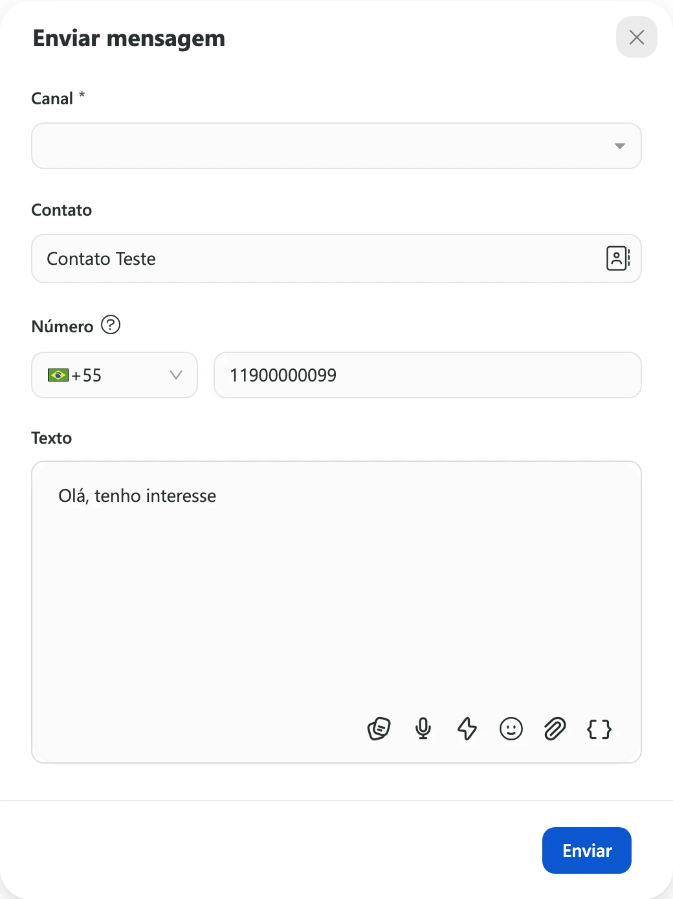

Monte um link para colocar no seu CRM, ERP ou planilha que abre a Kinbox direto na conversa de um contato pelo telefone — ou, quando ainda não existe conversa, abre a janela de nova mensagem com nome, texto e campos do contato já preenchidos.

<Note>
  Quem pode: qualquer membro logado na Kinbox no navegador. Quando nenhuma conversa é encontrada, o envio segue as permissões e regras de [Iniciar uma conversa com um contato](/docs/conversas/iniciar-conversa).
</Note>

## Montar o link

Use o mesmo endereço em que você abre a Kinbox (por exemplo, `https://app.kinbox.com.br`) com o caminho `/send` e o parâmetro `phones`:

```text
https://app.kinbox.com.br/send?phones=5511900000001
```

Informe o telefone em formato internacional, apenas com dígitos, incluindo DDI e DDD (como `5511900000001`): a busca compara exatamente com o número salvo no contato. Para procurar mais de um número no mesmo link, separe-os por vírgula.

### Parâmetros aceitos

| Parâmetro | Obrigatório | O que faz |
| --- | --- | --- |
| `phones` | Sim | Um ou mais telefones separados por vírgula (apenas dígitos, com DDI e DDD). |
| `text` | Não | Mensagem pronta (codificada para URL); usada apenas quando nenhuma conversa é encontrada. |
| `name` | Não | Nome do contato; usado apenas quando nenhuma conversa é encontrada. |
| `<chave_do_campo>` | Não | Qualquer outro parâmetro com a **chave reservada** de um [campo personalizado](/docs/configuracoes-no-workspace/campos-personalizados-no-kinbox) preenche esse campo do contato na janela de nova mensagem (por exemplo, `cpf=...`). |
| `workspaceId` | Não | Troca para o workspace indicado antes de buscar, se você participa de mais de um (se não houver acesso, exibe "Ambiente não encontrado" ou "Ambiente logado não corresponde"). |

### Passar os parâmetros em Base64

Se preferir, você pode enviar todos os parâmetros em um único campo `base64`, com um JSON codificado em Base64 (se o conteúdo for inválido, aparece "Link inválido"). Isso é apenas outra forma de escrever os parâmetros na URL e não esconde os dados, pois qualquer pessoa consegue decodificar Base64.

Exemplo em JavaScript:

```js
const dados = {
  phones: "5511900000001",
  name: "Cliente Exemplo",
  text: "Olá, tenho interesse",
};
const codificado = btoa(unescape(encodeURIComponent(JSON.stringify(dados))));
const link = `https://app.kinbox.com.br/send?base64=${encodeURIComponent(codificado)}`;
```

## O que acontece ao abrir o link

Ao abrir o link no navegador, a Kinbox exibe a janela **Pesquisar conversas** buscando os números informados:

- **Uma conversa encontrada:** abre essa conversa diretamente na [Caixa de entrada](/docs/conversas/caixa-de-entrada-do-kinbox).
- **Várias conversas encontradas:** exibe a lista para você escolher qual conversa abrir.
- **Nenhuma conversa encontrada:** abre a janela **Enviar mensagem** preenchida com **Contato** (`name`), **Número** (o primeiro número de `phones`, separando o `55` inicial como DDI) e **Texto** (`text`). Escolha o **Canal** e clique em **Enviar**.

<Frame caption="Janela Enviar mensagem preenchida pelo link quando nenhuma conversa é encontrada">
  
</Frame>

Quando há mais de um número em `phones`, apenas o primeiro é usado na janela **Enviar mensagem**. As permissões, canais disponíveis e regras de modelos do WhatsApp oficial dessa janela são os mesmos descritos em [Iniciar uma conversa com um contato](/docs/conversas/iniciar-conversa).

## Link de busca por campo personalizado

Também existe um link de busca pela chave e pelo valor de um campo personalizado do contato:

```text
https://app.kinbox.com.br/search?cfPlaceHolder=<chave_do_campo>&cfValue=<valor>
```

Ele aceita `base64` e `workspaceId` como o link acima.

<Note>
  **Hoje**, o link `/search?cfPlaceHolder=...&cfValue=...` abre a janela **Pesquisar conversas** sem aplicar o filtro pelo campo personalizado. Para achar conversas por um campo, use na [Caixa de entrada](/docs/conversas/caixa-de-entrada-do-kinbox) o filtro **Campo personalizado** (escolha o campo, digite o valor na janela "Filtrar por ..." e clique em **Filtrar**) ou o campo **Pesquisar** no topo da tela.
</Note>

Veja também [Para desenvolvedores: API, plugins, MCP e links](/docs/desenvolvedor/visao-geral).
